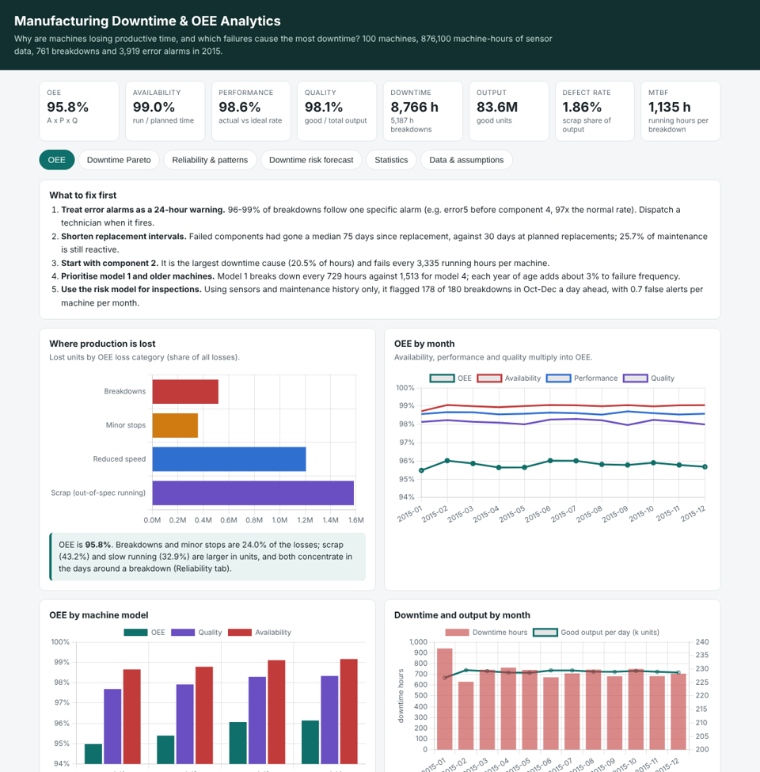
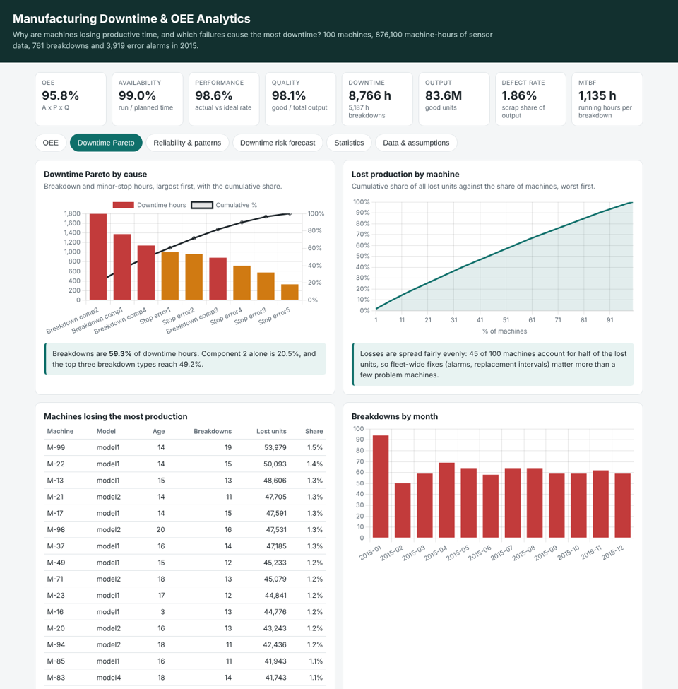
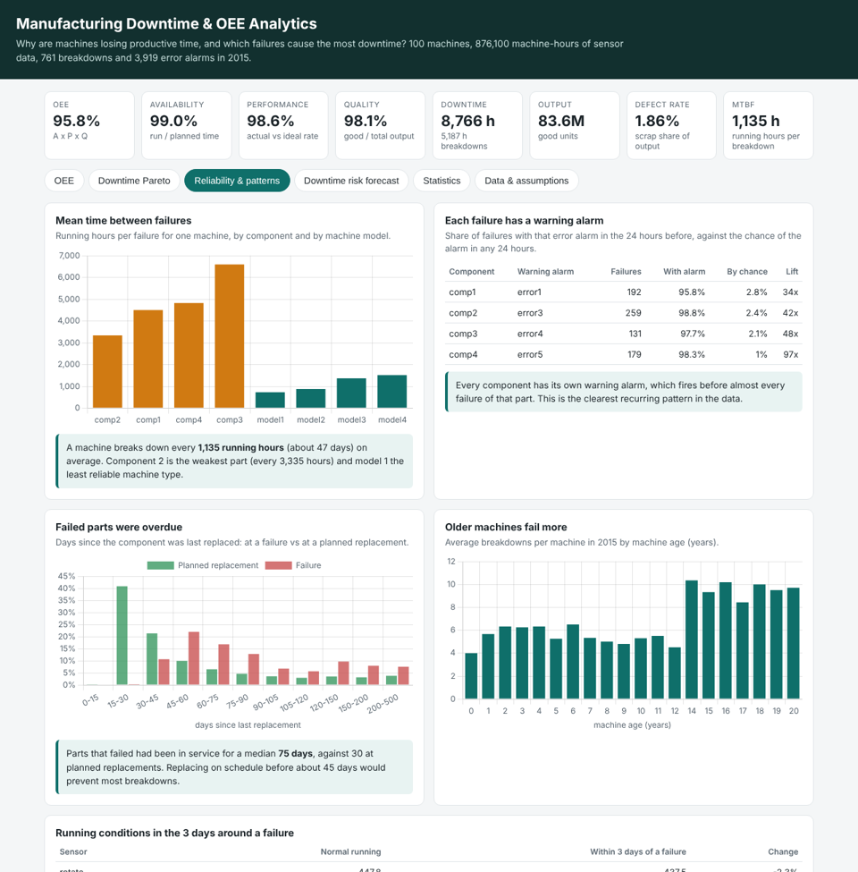
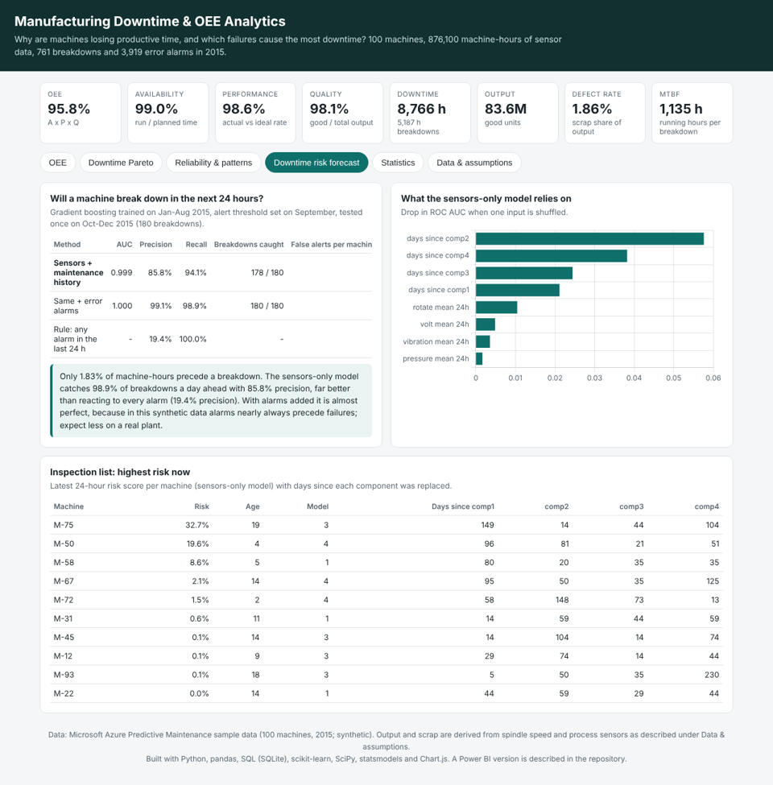
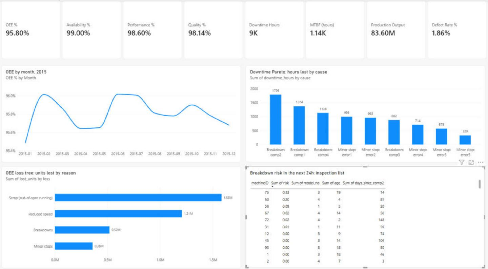

# Manufacturing Downtime & OEE Analytics


**Business problem:** why are machines losing productive time, and which failures cause the most downtime?

**Live dashboard:** https://khushal-narsaria.github.io/Manufacturing-Downtime-OEE-Analytics/



## Key findings

| Question | Answer |
| --- | --- |
| How effective is the fleet? | **OEE 95.8%** = availability 99.0% × performance 98.6% × quality 98.1%, over 100 machines and 872,627 planned hours in 2015. Model 1 is lowest at 95.0%. |
| How much time is lost? | **8,766 downtime hours**: 5,187 from 761 breakdowns and 3,579 from minor stops (error alarms). A machine breaks down every **1,135 running hours** (MTBF, about 47 days). |
| Which failures cost the most? | Downtime Pareto: **component 2 breakdowns 20.5%**, component 1 15.7%, component 4 13.0%. Breakdowns are **59.3%** of downtime hours. |
| Is there a recurring pattern? | Yes. **96–99% of breakdowns follow one specific error alarm in the 24 hours before** (error5 before component 4 at 97× its normal rate, error4 before component 3 at 48×, error3 before component 2 at 42×, error1 before component 1 at 34×). |
| Why do parts fail? | They are left too long. Failed components had been in service a median **75 days**, against **30 days** at planned replacements (Mann-Whitney p < 0.001); 25.7% of maintenance is still reactive. |
| Which machines? | Older machines and model 1. Failures rise about **3% per year of age** (Poisson regression), and model 1 breaks down every 729 hours against 1,513 for model 4. Losses are spread across the fleet (45 machines make up half), so fleet-wide policies matter more than a few bad machines. |
| Do breakdowns hurt quality and speed too? | Yes. In the 3 days around a breakdown, out-of-spec (scrap) hours rise from **1.5% to 4.7%** and machines run 2.3% slower. |
| Can downtime be forecast? | Using only sensors and maintenance history, a model trained on Jan–Aug flagged **178 of 180 breakdowns** in Oct–Dec a day ahead (precision 85.8%, recall 94.1%, 0.7 false alerts per machine per month), against 19.4% precision for reacting to every alarm. |

### What to fix first

1. **Treat each component's warning alarm as a 24-hour notice** and dispatch maintenance when it fires.
2. **Shorten replacement intervals** to about 45 days for components 1, 2 and 4.
3. **Start with component 2**, the largest downtime cause.
4. **Prioritise model 1 and machines over 13 years old** in the maintenance plan.
5. **Use the daily risk list** to plan inspections.

## Data

[Microsoft Azure Predictive Maintenance sample data](https://github.com/AbdelhafidhMahouel/predictive-maintenance-db/tree/main/data): 100 machines, hourly voltage, rotation, pressure and vibration for 2015 (876,100 readings), 3,919 error alarms, 3,286 maintenance records and 761 component failures. `python run.py` downloads it (80 MB). Microsoft built it as realistic synthetic data for maintenance analytics.

### Assumptions

The logs record breakdowns, alarms and maintenance, but not repair times, output or scrap. These are derived in one place ([`data.py`](src/oee/data.py)) and are shown on the dashboard:

| Item | Assumption |
| --- | --- |
| Repair time per breakdown | 8 hours |
| Minor stop per error alarm | 1 hour |
| Planned replacement | 2 hours, excluded from planned production time |
| Ideal rate | 100 units an hour at rated speed (the model's median healthy spindle speed) |
| Speed loss | only hours below the 5th percentile of healthy speed |
| Scrap | an hour where voltage, pressure or vibration is beyond 3σ of the model's normal running |

## Method

```
telemetry + alarms + maintenance + failures ─► hourly machine state (running, breakdown, minor stop, planned) ─► output, scrap
                                                       │
                     SQLite machine-day warehouse ◄────┤──► OEE = availability × performance × quality ─► loss tree
                                                       │──► downtime Pareto, machine Pareto, MTBF, alarm-before-failure lift
                                                       │──► hypothesis tests, Poisson regression
                                                       └──► 24-hour breakdown risk model ─► inspection list
```

| Step | What it does | Code |
| --- | --- | --- |
| **Cleaning** | Checks duplicates and missing hours, links 743 repairs to the failures they followed, separates 2,543 planned replacements | [`data.py`](src/oee/data.py) |
| **OEE** | Hour-by-hour state and output per machine; availability, performance and quality by machine, model and month | [`data.py`](src/oee/data.py), [`analysis.py`](src/oee/analysis.py) |
| **SQL** | Monthly OEE, OEE by model, failures by component, worst machines, time between failures (window function), planned vs reactive maintenance | [`sql/`](sql) |
| **Losses & Pareto** | Lost units by breakdowns, minor stops, reduced speed and scrap; downtime Pareto by cause and by machine | [`analysis.py`](src/oee/analysis.py) |
| **Patterns & statistics** | MTBF, alarms before failures (lift over chance), part age at failure, sensor drift before failures, 4 hypothesis tests, Poisson regression | [`analysis.py`](src/oee/analysis.py) |
| **Risk forecast** | Gradient boosting on rolling sensor statistics, alarm counts, days since each component was replaced, age and model; time-based split | [`forecast.py`](src/oee/forecast.py) |

### Downtime Pareto

| Cause | Downtime hours | Share | Cumulative |
| --- | ---: | ---: | ---: |
| Breakdown: component 2 | 1,795 | 20.5% | 20.5% |
| Breakdown: component 1 | 1,374 | 15.7% | 36.2% |
| Breakdown: component 4 | 1,136 | 13.0% | 49.2% |
| Minor stop: error1 | 998 | 11.4% | 60.6% |
| Minor stop: error2 | 963 | 11.0% | 71.6% |
| Breakdown: component 3 | 882 | 10.1% | 81.7% |



### Hypothesis tests

| Hypothesis | Test | Result | p |
| --- | --- | --- | ---: |
| Older machines fail more often | Spearman | ρ = 0.50 | < 0.001 |
| Failure frequency differs by model | Kruskal-Wallis | model 1: 11.8 a year … model 4: 5.7 | < 0.001 |
| Failed parts had gone longer since replacement | Mann-Whitney U | median 75 vs 30 days | < 0.001 |
| Scrap is more likely around a failure | Chi-square | 4.7% vs 1.5% of hours (3.1×) | < 0.001 |

**Poisson regression** (breakdowns per machine, pseudo R² = 0.62): each year of age ×1.03, each error alarm ×1.02, model 3 ×0.60 and model 4 ×0.58 against model 1.



### Breakdown risk in the next 24 hours (test: Oct–Dec 2015)

| Method | ROC AUC | Precision | Recall | Breakdowns caught |
| --- | ---: | ---: | ---: | ---: |
| **Sensors + maintenance history** | 0.999 | 85.8% | 94.1% | 178 / 180 |
| Same + error alarms | 1.000 | 99.1% | 98.9% | 180 / 180 |
| Rule: any alarm in the last 24 h | – | 19.4% | 100% | – |

The strongest inputs are the days since each component was replaced, then speed and voltage. With alarms included the model is almost perfect because in this synthetic data each failure is preceded by its alarm; a real plant will be noisier, so the sensors-only model is the one to judge.



## Dashboard

| KPI | Purpose |
| --- | --- |
| OEE (availability × performance × quality) | Overall equipment effectiveness |
| Downtime hours | Breakdowns and minor stops |
| Production output | Good units |
| Defect rate | Scrap share of output |
| Mean time between failures | Reliability |

The [live dashboard](https://khushal-narsaria.github.io/Manufacturing-Downtime-OEE-Analytics/) has six pages: OEE and recommendations, downtime Pareto, reliability and patterns, the risk forecast and inspection list, statistics, and data checks with assumptions.

### Power BI report

[`powerbi/Manufacturing_OEE_Dashboard.pbix`](powerbi/Manufacturing_OEE_Dashboard.pbix) is the production manager's view in Power BI Desktop: KPI cards (OEE, availability, performance, quality, downtime hours, MTBF, output, defect rate), OEE by month, the downtime Pareto, the OEE loss tree and the 24-hour breakdown-risk inspection list. The model links `dim_machine` to `fact_machine_day` and `risk_scores` on `machineID`; the measures are written in DAX.



`powerbi/data/` holds the model tables, [`powerbi/measures.dax`](powerbi/measures.dax) the full measure set, and [`powerbi/POWERBI_GUIDE.md`](powerbi/POWERBI_GUIDE.md) how to rebuild or extend the report.

## Run it

```bash
python -m venv .venv && source .venv/bin/activate
pip install -r requirements.txt
python run.py                       # downloads the data, writes results/, docs/data.json and powerbi/data/
pytest -q                           # 10 tests on a small synthetic fleet
python -m http.server -d docs 8000  # dashboard at http://localhost:8000
```

## Tests

The 10 tests check that repairs are linked to their failures, that downtime hours match the assumptions, that OEE equals availability × performance × quality, that stopped machines produce nothing and scrap never exceeds output, that planned maintenance is excluded from planned time, that the loss tree adds up to all lost units, the Pareto maths, that an alarm before a failure is detected, that **forecast features never use future data**, and that every SQL query runs.

## Limitations

- The data is synthetic, and repair times, output and scrap are derived from stated assumptions, so the absolute OEE (95.8%) is higher than a typical plant's; the comparisons and rankings are the useful part.
- Failures are only logged at 06:00, so time-of-day patterns cannot be studied.
- The fleet runs 24/7 and every hour counts as planned production time.

## Author

**Khushal Narsaria** · [Portfolio](https://khushal-narsaria.github.io/) · [LinkedIn](https://www.linkedin.com/in/khushal-narsaria/) · [GitHub](https://github.com/Khushal-Narsaria)
